# NeurIPS 2025 游记 (12/01/2025-12/07/2025)

## 11.30 收拾

从 7 月 Radial Attention 刚刚出分的时候，YL 学长便和我说 12 月可以一起去 NeurIPS，于是我对第一次线下开会的期待便开始了。因为分数还算不错，所以倒是没怎么担心过 paper 能不能中。然而实际结果出来的时候还是非常欣喜的，一方面觉得一个学期以来的努力没有白费，终于有第一篇顶级 AI conference 的 paper 了；另一方面来说，Radial Attention 还是我非常喜欢的一个工作，用一个很简单易懂的 intuition 编织了 $\mathcal{O}(n\log n)$ 的 Attention，并且确实在生成长视频的时候效果也不错（和 dense attention 效果相当）。并且和我在 SJTU 科研实习的两个工作相比，关心的问题更重要、影响力更大、并且也厚实不少。

有了 Radial Attention 之后了，我在 MIT 暑研的日子没有那么苦涩了，害怕与清华 intern 们竞争的我也有底气和他们一起加油、一起做朋友；我也开始以更高的要求约束自己做科研，不要愧对自己。我也有信心出去多认识点其他实验室的人，跟他们讨论我对读 Ph.D. 的愿景、对各种新东西的兴趣。而这些自信上的提升也让我更加期待 NeurIPS 线下开会，我想认识视频生成领域的先锋们、想认识学界里崭露头角的学术新锐们 (rising stars)、想认识工业界有资源也有理想的顶级团队 (frontier labs)。其他种种胡思乱想暂且不表，且让我先“如实汇报”这一周忙碌开会的体悟吧。

## 12.1 报到

这一天早上非常的慌乱。我的飞机在 16:00 起飞，我有一套衣服没有洗、也没有烘干 (这大概要花费 2.5 小时)，我还要去实验室收拾海报和英伟达的 Spark GPU。经过一番倒腾，我幸运地收拾了所有东西，带着我的书包、一个登机箱、一个装着 Radial Attention 海报和 Spark GPU 的袋子登上了前往圣地亚哥的飞机。

经过 6 个小时的长途飞行，我们在加州时间 19 点抵达了圣地亚哥。刚走出机场，我便被圣地亚哥市宽敞的车道、高耸的棕榈树、凉爽的气候所吸引。要知道，这里的纬度要高于上海，但是在上海已经进入晚秋、人们要拾起加绒的厚衣服时，你在圣地亚哥市只需要穿一件短袖一件冲锋衣就行。如此清爽的体验让我初来乍到便对这里印象非常好。

我们的酒店、会议场馆、机场都在圣地亚哥市的中心，于是我们很快便到达了酒店。美国的酒店价格要比国内高上 6～7 倍，我们住的这家酒店大概相当于中国 4-5 星级，但是一晚上要 450 美元（约合人民币 2200 元）。得亏韩老师报销，不然不知道要浪费多少钱。晚上我们体验了美国的 cheesecake factory，美剧《生活大爆炸》里的 Penny 之前就曾在此工作，也算是呼应了小时候看美剧的我对美国的胡思乱想。点了一份牛排+薯条+四季豆，花了 30 美元。

晚上把 Spark GPU 交付给了实验室学长开的创业公司，供他们在这几天 NeurIPS 做展示。随后便收拾一下睡觉了。希望大佬们创业的时候能想起来带带我。

  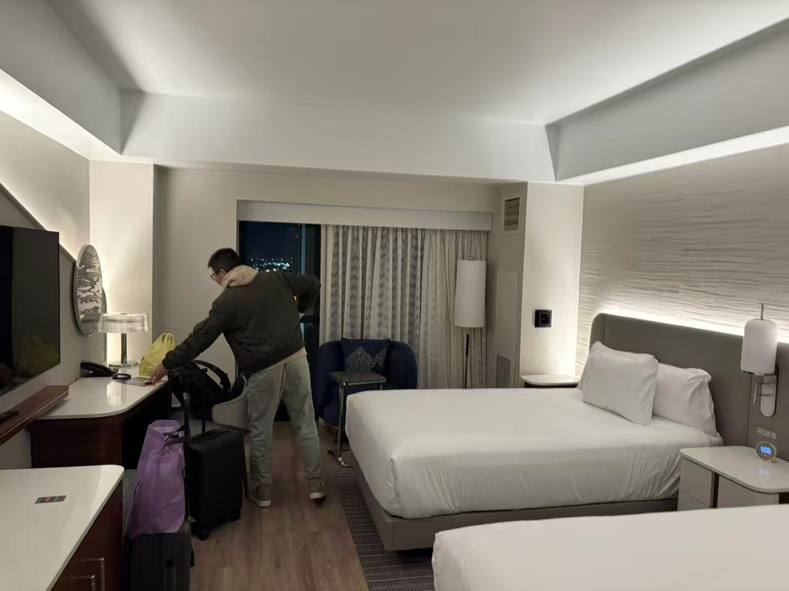
  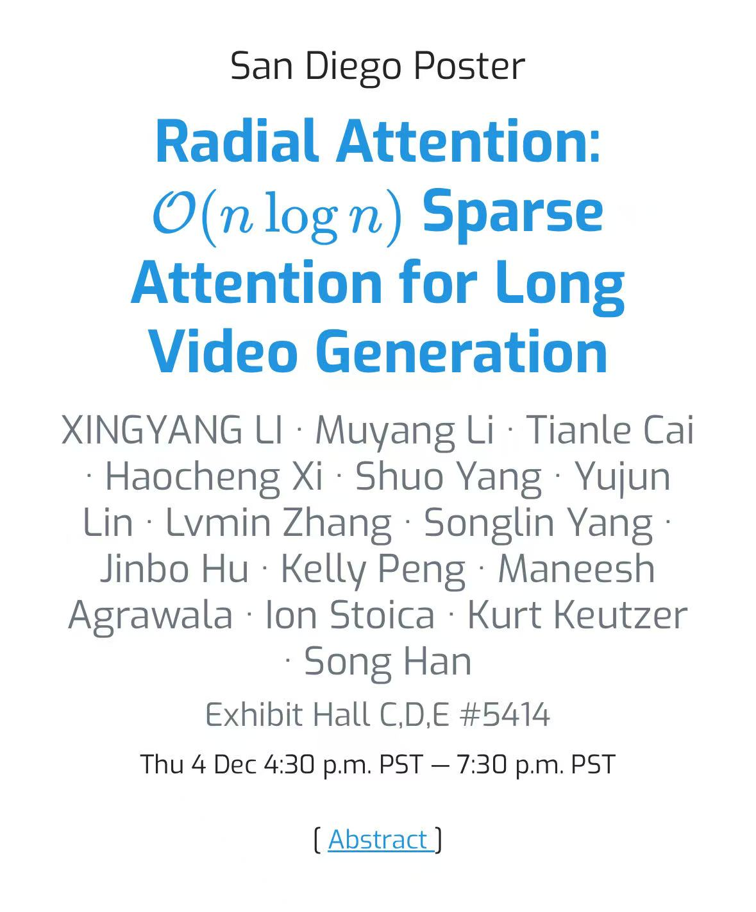

## 12.2 注册/熟悉会场

早上一起来之后便被窗外的景色吸引：我们所住的圣地亚哥市旁边就是太平洋，而太平洋的另一端就是我朝思暮想的祖国。清早的太平洋看着风平浪静，海边停泊着许多高级游艇，向我们昭示着这资本主义的国度是多么纸醉金迷。

  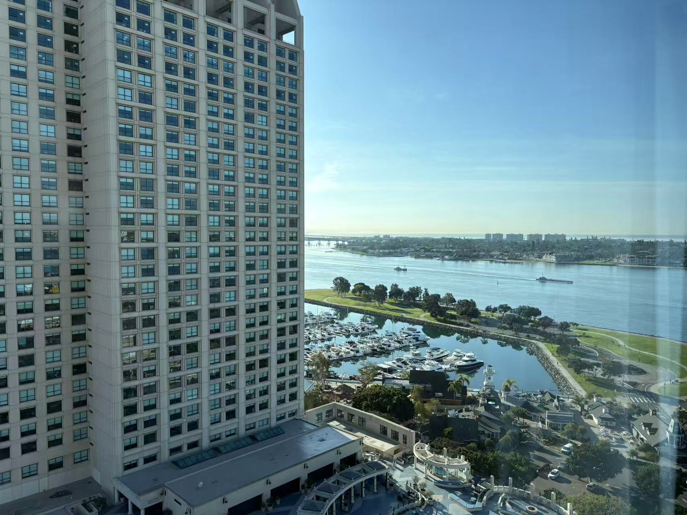
  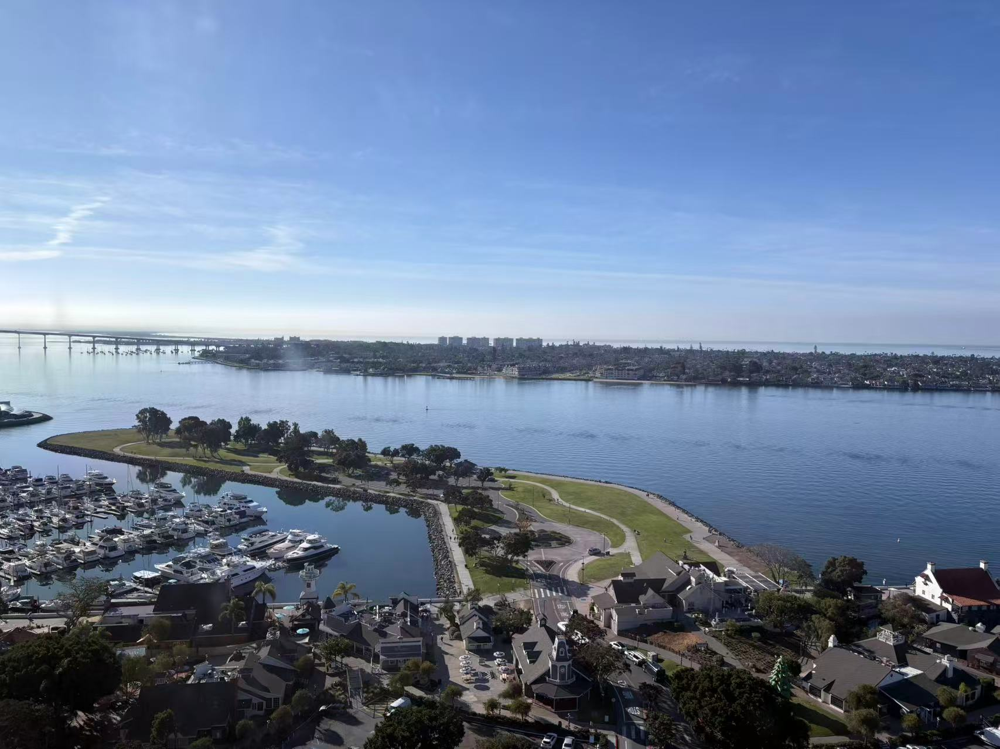

简单吃完早饭、在海边走了一会儿之后，我便来到会场注册，不一会儿就拿到了印着自己名字和 MIT 的小牌子，确实戴起来挺令人觉得虚荣的。然后我便开始了听讲座的过程，我上午关注的是一个 Energy-centric ML 的教学讲座，乍一听挺有意思，但本质上是把在线算法和凸优化与现代计算单元的能耗建模相结合，感觉对我主要的启发还是停留在思想方面，实际技术上或许并没有那么令人激动。这也基本和我的朋友 YP 所讲的吻合。

中午和几位 UC Berkeley 的学长吃完饭后，我便回到会场开始逛企业展台，在这里，许多科技大厂和金融公司都在发放自己公司的礼品、以及若干招募实习的问卷。我作为本科生自然只是以观察为主，可能等未来真的浸润到工业界之后，才能更了解其中更深刻的内涵。

临近傍晚的时候，终于争取到一个比较重要的机会：SY 学长和目前视频生成领域的大牛 XH 老师约到了单独见面的机会。我于是立刻和另外几位师兄前去蹭这一次难得的交流机会。总之确实学到了很多。

  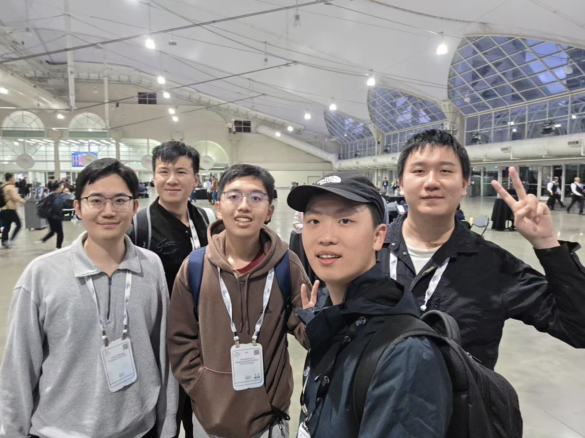
  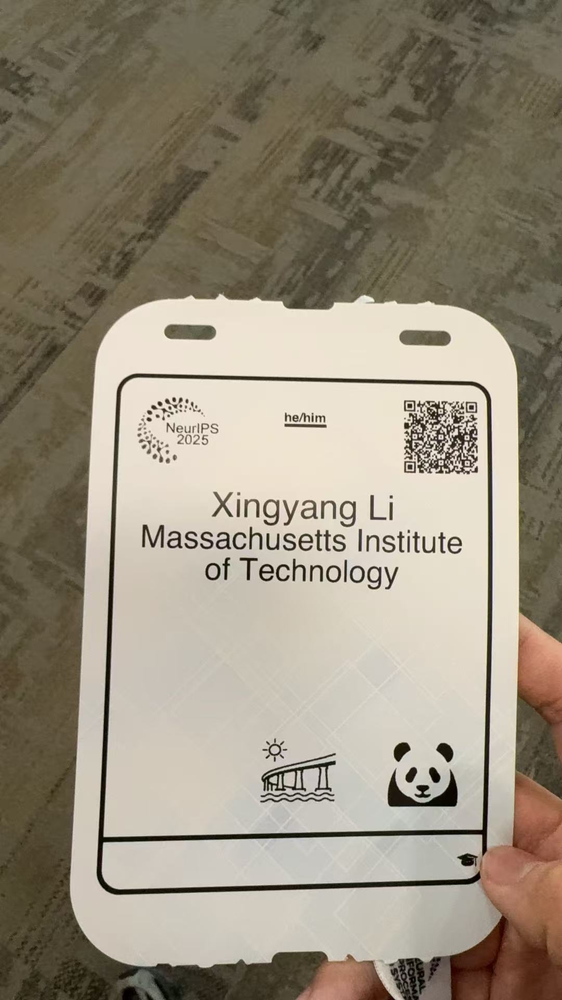

## 12.3 观察海报/参加饭局

3 号早上我并没有急着去开会，考虑到第一批海报 11:00 才开始展示，我先在房间里花了一点时间学习了 XH 老师的大作 Self-Forcing，结合我现在在飞机看的他的关于世界模型的博客，我更加意识到他的思想的深度，也明晰了之后要研究的方向。

下午终于见到了本科同学们，稍微寒暄之后我们便一起逛企业展台，之后稍微看了会儿海报，主要也是和之前就认识的朋友们聊天。这中间还有一个小插曲，JZ 师兄嗓子发炎了不太方便讲话，我于是便帮他讲了 30 分钟海报 (主要是我也对他的工作都滚瓜烂熟了)。

晚上参加了上文所述的学长的创业公司的饭局，人实在是太多了，饭局上 YZ 学长主动找到我聊天，聊的内容也不过是休学去工作/学术界无法实现理想的问题，但好在在遥远的 MIT，在韩老师这边，这些噪音都很难真正烦扰到我。晚饭后我便和好兄弟 YC 聊了会儿天，一起在健身房见了会儿，挥别他之后，我便又得以一个人享受舒适但又空荡荡的酒店房间。

躺在床上，我有些迷茫和失望：下午在逛海报的时候，清华大学的校友们在快乐地交流，其中也不乏多位理论/人工智能/计算机系统的大牛。相较之下，交大 ACM 班的校友则少了很多，大家也都是分别各干各的，即便同在会场也没啥交流。希望之后 ACM 班的传帮带能变得再强一点，现在的校友网络还是太小、也太稀疏了。

## 12.4 讲海报

今天是我讲海报的日子。我的海报在下午展示，于是早上我首先把经过“舟车劳顿”，已经有点褶皱的海报摊平，接着洗漱了一下，就直接去会场逛上午场的海报了。一场展览有将近 1000 张海报，可以想见会有多拥挤。我和 YC 计算了一下，即便是走马观花，也需要 1 个小时才能看完所有海报，可见现在人工智能领域的火热程度。在这样论文爆炸的时代，中一篇论文本身的意义已经被稀释得不剩多少，可能真正有用的还是在一个有影响力的组、发一篇有影响力的论文。如此这般，才能最大程度上避免成为沧海遗珠。这里就要感谢 ML 和韩老师不遗余力的宣传、以及从想方法到写论文到剪宣传视频对我的历练。

中午和 ACM 班的学长们聚餐 (吃昂贵的巴西烤肉😭) 之后，下午便正式进入了最重要的环节：我的海报展示。每个人有一个 2 米 $\times$ 1 米的海报，并且有一大块区域供聆听者们驻足。开始讲海报之前，我曾十分担心会不会出现冷场的情况。但好在有韩老师在旁边站台，也有一些认识的朋友一起观摩，于是我也成功地被要了十几次微信和领英账号，跟许多人不遗余力地推销我的工作，也算是尽兴了。从投稿到现在的半年，视频生成领域也算是发生了不少革新。自己的工作和海报能收到关注固然很好，但是也是时候该踏上新的旅程了。

晚上和 YL 师兄吃了一家日式寿司店，不过圣地亚哥大概还是墨西哥菜和地中海菜的主场，寿司味道不能算好。连续三天在会场的高强度健走和今天一整个下午的讲演让我十分疲惫，于是十点多就睡着了。

  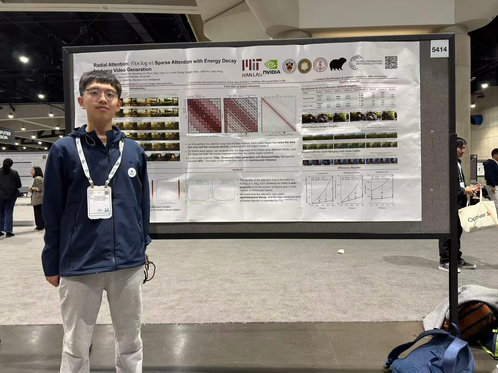
  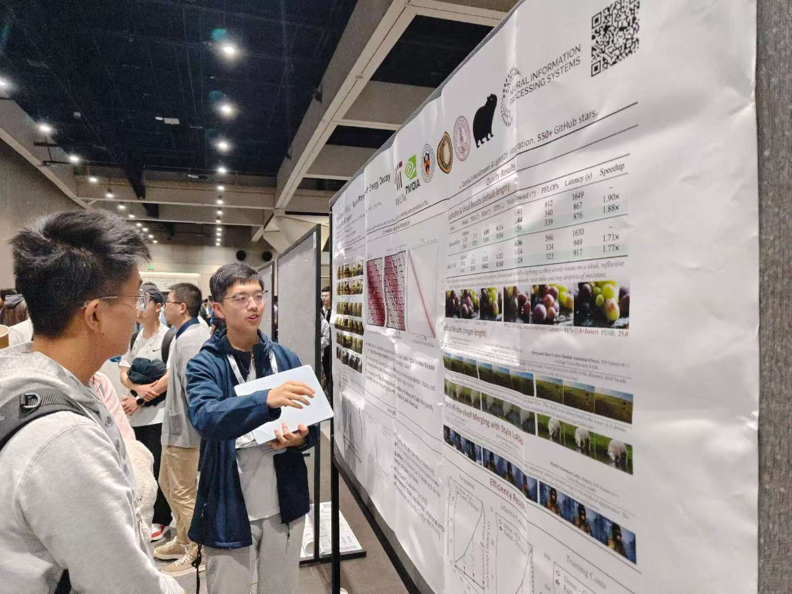

## 12.5  圣地亚哥半日游

突然意识到，NeurIPS 对于申请季的我，还兼具社交的用途。诚然，我前几天约了几位学长，但作为学术小白，我尚不敢直接约那些我申请的老师。但是承蒙 YL 学长的人脉，我在这天早上终于约到了 BZ 老师。BZ 老师是我非常崇拜的对象：四大 Ph.D. 毕业，又找到了顶尖学校的教职，同时创业也非常成功。BZ 老师很慷慨地向我介绍他未来的方向，同时也鼓励我在申请的同时也要关注工业界的更多机会，总之感觉这次聊天很轻松，也让我对未来更有信心了。

中午是和实验室师兄们的聚餐。作为最年轻成员的我自然是全程透明人，不过见到之前膜拜的一篇篇论文的作者，也足够激动人心了。

鉴于下午没看到什么特别有意思和海报，我和 YH 师兄决定去看航空母舰，然后在圣地亚哥打打球。我一直自诩为一个“闲人”，会在高考复习最紧张的时候去操场踢很久足球、会在高三疫情封控在家时每天弹很久吉他，会在本科期末考前突然坚持每天跑步。总之，我的行动力和注意力经常会耗散在许多和正业并不相关的事情上，这也导致在美国暑研的这段时间里，我似乎一直无法和实验室的师兄们在娱乐时间/内容上同频，但好在我也逐渐习惯了一个人骑行、旅游的过程。

不过好消息是，YH 师兄恰巧在这方面与我有一些共鸣，于是我们便一拍即合，一起逛逛圣地亚哥。我们最感兴趣的景点便是会展中心边的中途岛号航空母舰。我和 YZ 学长在船内欣赏一台台过去的战机，登上甲板，体验海军大兵们的感觉。在甲板边缘望着夕阳染红了天边，还真的挺有意思的。我也趁机复刻了我最迷恋的“起飞”动作。

  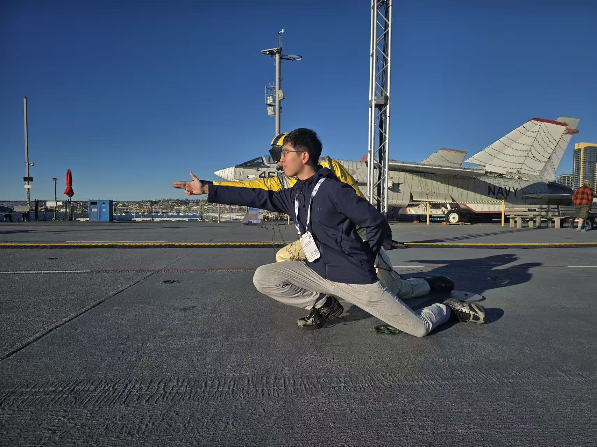
  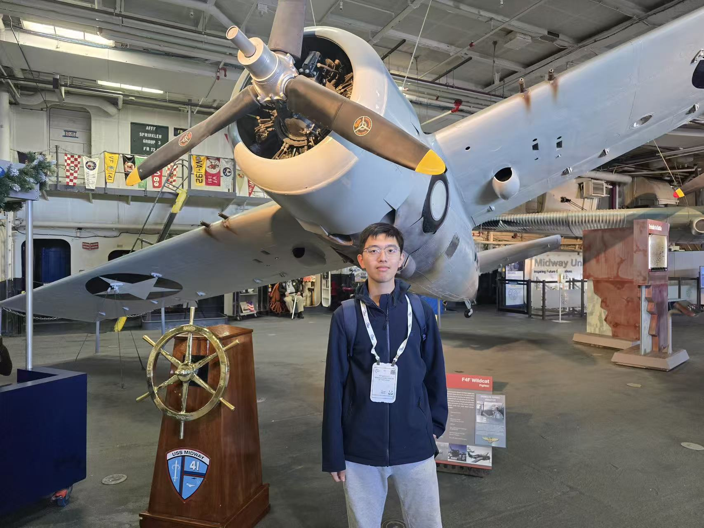

看完航空母舰之后，我们便打车前往乒乓球馆。我来 MIT 实习之后，曾短暂地在 MIT 乒乓球俱乐部打练习赛，也曾被实验室元老 GX 师兄暴打，总之，我似乎球技没有变好，而且对自己乒乓球的实际水平越来越迷惑了。听闻 YH 学长很喜欢乒乓球，也是清华某系的院队守门员，于是便叫上他切磋切磋。

YH 学长最喜欢的是张继科，但他最无解的技能却是正手爆冲和台内挑打。首次交手我被这两项技能打得落花流水，被直取四局。调整片刻后，不知是 YH 学长体力不佳，还是他有意让我，我才狼狈地以 3:1 拿下第二回。感觉自己从力量到球感上都差太远了，究其原因还是菜，养生球打多了，还得多练。

打完球后已是饭店，于是我们来到海边的 Coronado 岛吃完饭。吃完之后，我们选择坐轮渡回到酒店。

我在上海坐过很多次轮渡，但大多数都是大学之后坐的。在学业压力尚未很大的大一时光，我曾和几位好友穿梭在黄浦江两岸，骑车欢笑在上海的晚风中。但到大三之后，我们骑行的次数则降到一学期甚至一年一次，也不怎么骑过江了。希望自己能在本科生涯所剩无多的几个月里，多放松放松吧，没必要太赶了。

  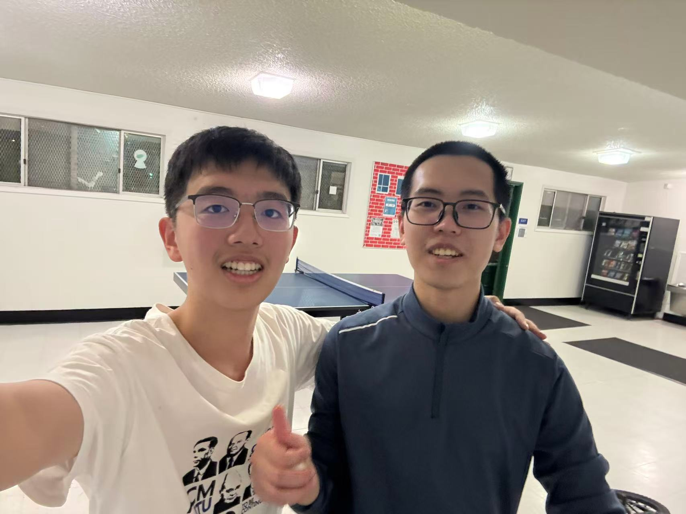
  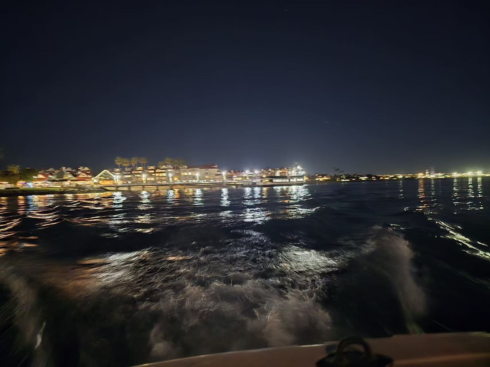

## 12.6 休憩

这天基本没做什么，早上去了一下健身房，下午和师兄随缘逛了一下工作坊 (workshop)，晚上和 ZL 师兄和 JH 学弟吃了一顿饭，也就回酒店休息了。感觉自己也慢慢对开会有些祛魅，也真的有些疲惫了。

## 12.7 圣地亚哥一日游

经过前几天在会场附近的折腾，我已经觉得会场最后几天的工作坊没什么好看的，于是便和 CZ 师姐租了车，在圣地亚哥附近转了转。

我们上午在墨西哥风格的 Old Town Historic Park 逛了一圈，墨西哥风格的建筑确实和我在寻梦环游记 (Coco) 中看到的相差不大， 我也买了一些小礼品带给实验室师兄和亲人们。（但是非常遗憾的是，实验室师兄们审美和我出入比较大，我还是自己多留着点吧）

  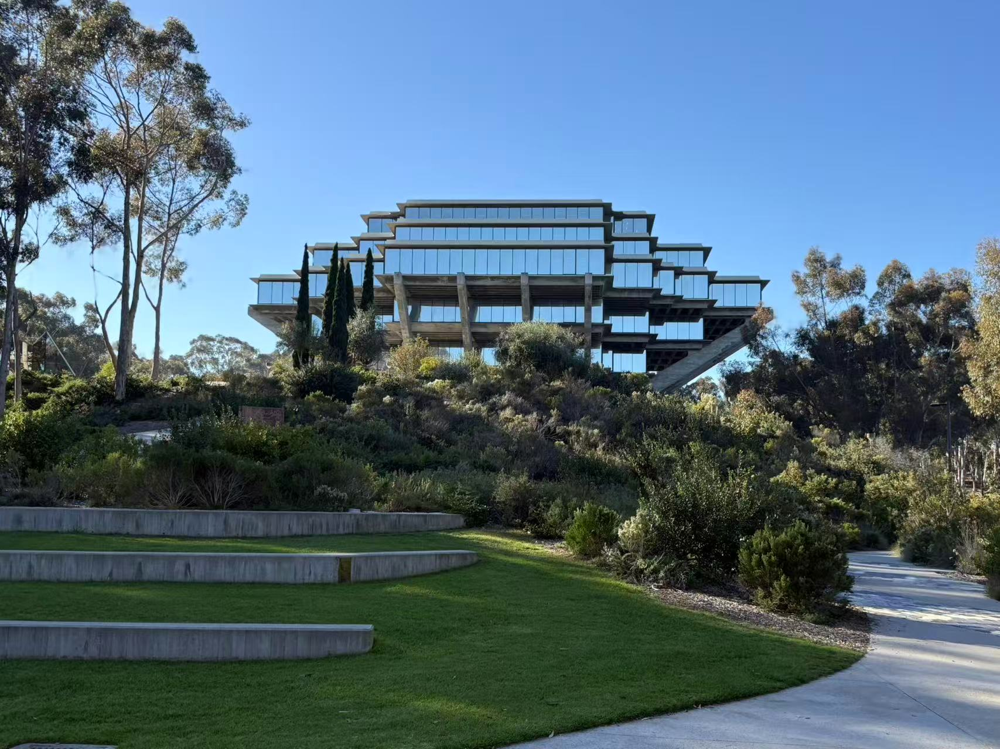
  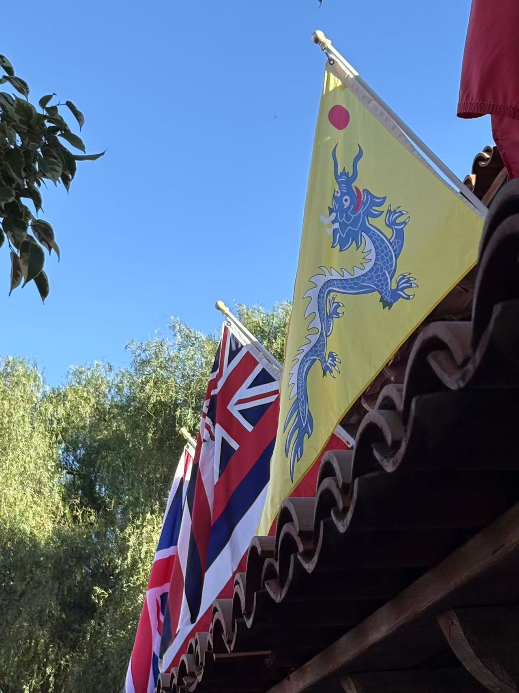
  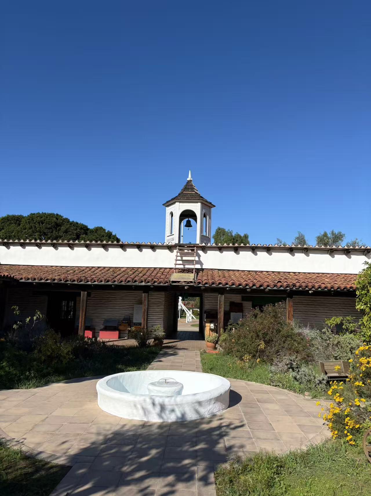

下午我们主要是在 UCSD (加州大学圣地亚哥分校) 逛，UCSD 的校园非常大，并且因其非常优越的地理位置，气候冬暖夏凉。此时此刻，在波士顿的寒冬里写这段博客的我，仍然非常想念 UCSD 的校园。近几年，UCSD 也一跃成为计算机科研领域的新贵：许多位年少有为的年轻教授加盟计算机学院，并且在各个顶会上都能看到 UCSD 的优秀论文出现。。再加上优越的地理位置和气候，UCSD 确实是计算机科学申请的不二选择。希望我以后能继续有机会来这里玩。

晚上，在圣地亚哥的最后一个夜晚，我们开车来到了 La Jolla 海滩。西海岸的落日和一望无垠的海面，构成了圣地亚哥最美的景色。确实，东海岸适合看日出，而西海岸适合看落日。我也在这里遇上了我的好损友 YC，我们一起在夕阳旁边散步，调侃着学界的种种离奇和申请 Ph.D. 的重重困难。但好在，无论发生什么，我们仍然拥有许多朋友，以及许多值得继续坚持的理由。

  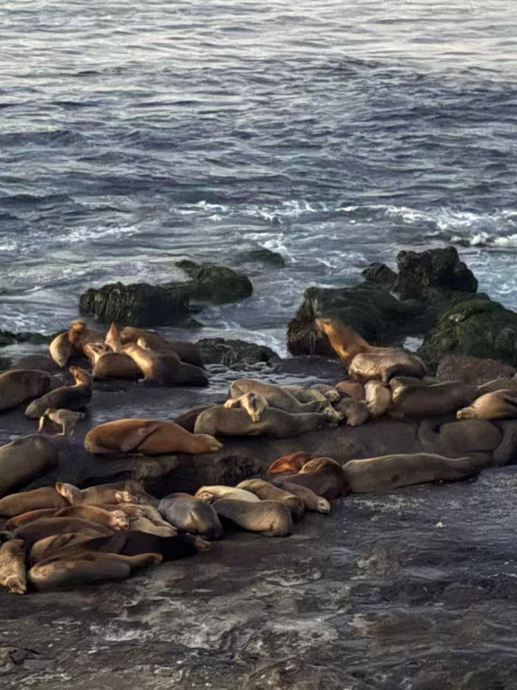
  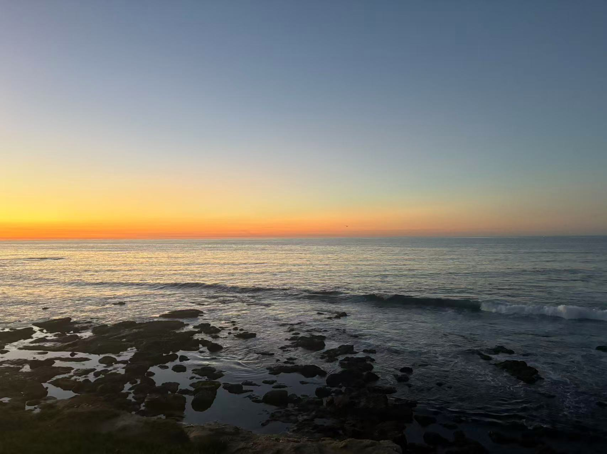
  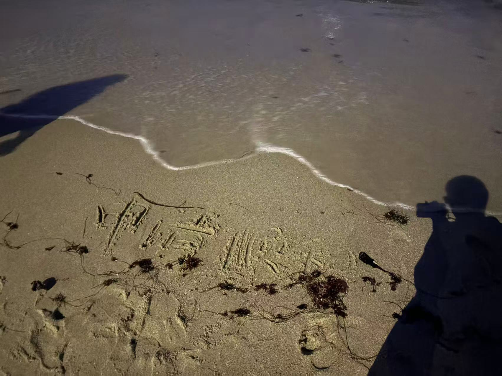

## 12.8 归途

NeurIPS 带给我的是什么呢？是第一篇在 AI 顶会的 paper，第一次跟大人物们线下见面的机会，还是第一次在美国旅游的体验？我想都是。对未来的我而言，即便我不能每天都像开 NeurIPS 的那个 20 岁的我一样，有“一日看尽长安花”的热情，有“我辈岂是蓬蒿人”的狂气，但往后五年、甚至十年的我，仍然会努力在风雨飘摇的学术界坚持做好自己，和最好的伙伴，做最重要的事情。

最后，祝所有 (忍耐了我的文笔并) 看到这里的朋友们，无论在哪里，都能美梦成真！